# Aegis – employee & access portal

**Who works here, what may they access, and who approved it.** Aegis keeps the employee directory, runs access requests through an approval workflow, tracks mandatory trainings and handles support tickets – with a built-in assistant that answers from your own data.

### ▶️ [Try the demo in your browser](https://tibortoth8807.github.io/Aegis/) – switch persona in the top-right corner (employee, manager, HR, security officer, admin)

[](https://github.com/tibortoth8807/Aegis/actions/workflows/backend.yml)
[](https://github.com/tibortoth8807/Aegis/actions/workflows/frontend.yml)

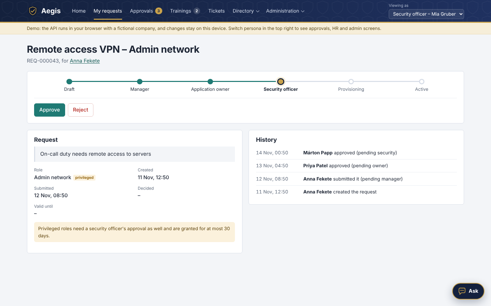

| | |
|---|---|
| **Backend** | .NET 10, ASP.NET Core REST API, EF Core **code first** (SQL Server, SQLite), clean architecture |
| **Workflows** | **State pattern** – one class per state, no `switch` over a status field |
| **Errors** | **Central exception handling** – `IExceptionHandler` → RFC 9457 problem details with stable error codes |
| **Frontend** | React 19 + TypeScript, Vite, no UI library; runs against the API or fully in the browser (demo) |
| **Assistant** | Chat in the bottom-right corner; built-in rules, or a local LLM through **Ollama** (free, no sign-up), or any OpenAI-compatible endpoint |
| **Tests** | 4 layers: **unit** (MSTest + Moq), **integration** (real API + database), **performance** (own load-test framework with thresholds), **UI** (Playwright, page objects) |

## What it does

- **Employees** – directory with search, filters and sorting; registration of joiners (internal and external), editing with optimistic concurrency, the employment lifecycle (preboarding → active → on leave → offboarding → left). Leavers lose all their access automatically.
- **Access requests** – request a role in an application for yourself or (as a manager) for your report. Approval by the manager, then the application owner; privileged roles also by a security officer and for at most 30 days. Four-eyes rules: nobody approves their own request, nor two steps of the same one. Applications with automatic provisioning get the access right after the last approval (LDAP group membership; other connectors plug in behind `IProvisioningGateway`), the others are provisioned by an administrator.
- **Rules before requesting** – duplicates, already granted access, at most 5 open requests, and *required trainings*: e.g. the CRM can only be requested with a valid data-protection completion.
- **Trainings** – mandatory courses are assigned on the first day; pass marks, attempts, validity, overdue and expired completions, waivers by HR, managers assigning courses to their team.
- **Tickets** – problems with access or employee data, with priorities and response times (SLA), a support queue, hold / resolve / reopen and automatic closing.
- **Export lists** – employees, managers, privileged access, access report, training compliance – as formatted **Excel** (frozen, coloured header, auto-filter) or CSV, depending on your roles.
- **Directory import** – LDAP export (LDIF) or HR CSV, or directly from an LDAP server: **preview first**, then apply; missing people are reported, not deleted.
- **Daily jobs** – joiners start, leavers leave, access and trainings expire, resolved tickets close. Idempotent: running them twice changes nothing the second time.
- **News**, reference data (departments and teams, locations, nationalities), role-dependent menus with live counters.

## The state pattern – the backbone

The legacy way to do workflows is a status column and a switch (or a chain of `if`s) in every method, growing with every new rule. Here each workflow has an abstract state class with one virtual method per action, and **one class per state** overrides only the actions that make sense in it:

```csharp
public abstract class AccessRequestState : StateBase<AccessRequestStatus>
{
    [Transition("approve")]
    public virtual AccessRequestState Approve(AccessRequest r, TransitionContext ctx) => throw NotAllowed(Entity, "approve");
    // submit, reject, cancel, provision, revoke, expire ...
}

private sealed class PendingOwnerState : PendingState
{
    public override AccessRequestStatus Status => AccessRequestStatus.PendingOwner;

    public override bool CanDecide(AccessRequest r, Actor actor) =>
        IsNeutral(r, actor) && (actor.EmployeeId == OwnerOf(r) || actor.IsAdmin);

    public override AccessRequestState Approve(AccessRequest r, TransitionContext ctx) =>
        ApproveStep(r, ctx, RoleOf(r).Privileged ? PendingSecurity : Approved);
}
```

- The entity stores only the status (that is what the database keeps); `AccessRequestState.Of(status)` returns the stateless singleton.
- **Allowed actions are derived** from which methods a state overrides (`[Transition]` + reflection) – the UI shows exactly those buttons, the API refuses the rest with `409 state.transition`.
- Every transition is recorded with actor, time and comment (owned history tables); entry actions set dates and validity.
- Adding a state = adding a class. The same pattern drives four workflows:

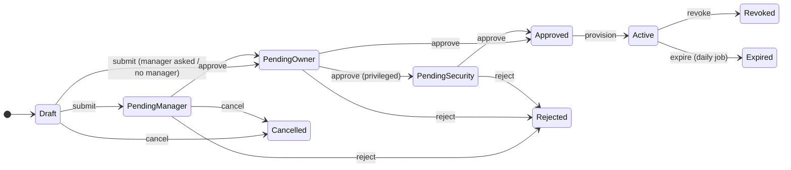

| Workflow | States | Code |
|---|---|---|
| Access request | Draft, PendingManager, PendingOwner, PendingSecurity, Approved, Active, Rejected, Cancelled, Expired, Revoked | [`AccessRequestStates.cs`](src/Aegis.Domain/Access/AccessRequestStates.cs) |
| Employee lifecycle | Preboarding, Active, OnLeave, Offboarding, Left | [`EmployeeStates.cs`](src/Aegis.Domain/Employees/EmployeeStates.cs) |
| Training assignment | Assigned, InProgress, Completed, Overdue, Expired, Waived | [`TrainingStates.cs`](src/Aegis.Domain/Training/TrainingStates.cs) |
| Ticket | New, InProgress, OnHold, Resolved, Closed, Cancelled | [`IncidentStates.cs`](src/Aegis.Domain/Incidents/IncidentStates.cs) |

## Central exception handling

Services and the domain just throw; controllers have no `try/catch`. One [`IExceptionHandler`](src/Aegis.Api/Hosting/ExceptionHandling.cs) maps every exception to a problem response with a stable `code` and the `traceId`:

| Exception | Status | Example `code` |
|---|---|---|
| `ValidationFailedException`, model binding errors | 400 | `validation` (with field errors) |
| `ForbiddenException` | 403 | `forbidden` |
| `NotFoundException` | 404 | `not_found` |
| `InvalidStateTransitionException`, concurrency conflicts | 409 | `state.transition`, `concurrency` |
| `BusinessRuleException` | 422 | `request.duplicate`, `request.training_required`, … |
| anything else | 500 | `internal` – logged, details only in Development |

```json
{ "type": "https://httpstatuses.io/409", "title": "Not possible in the current state", "status": 409,
  "detail": "Cannot approve a request that is rejected.", "code": "state.transition", "state": "rejected", "action": "approve",
  "traceId": "00-6f1b…" }
```

## Architecture

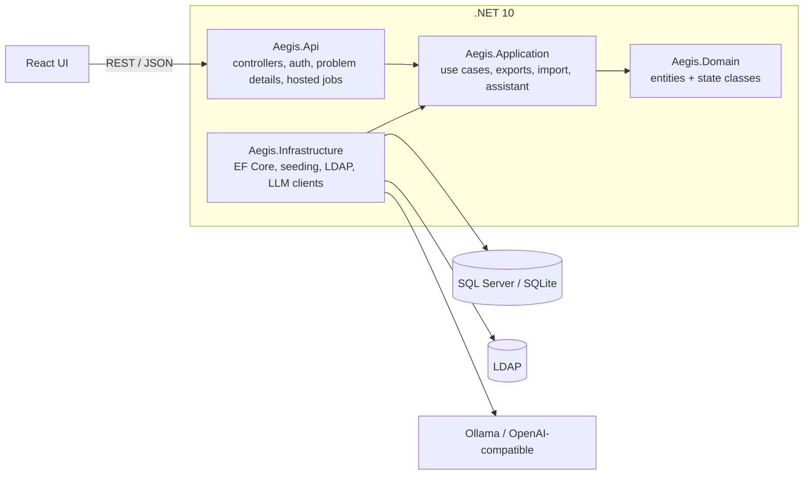

```text
src/
  Aegis.Domain/          entities, the four workflows as state classes, domain exceptions - no dependencies
  Aegis.Application/     services per area, DTOs, rules that need the database, Excel/CSV writers,
                         LDIF/CSV directory import, daily jobs, assistant (intents EN/HU + LLM fallback)
  Aegis.Infrastructure/  AegisDbContext (code first), DemoSeeder, LDAP provisioning + directory source,
                         Ollama / OpenAI chat clients, the assistant's data access
  Aegis.Api/             thin controllers, demo authentication, exception handler, daily jobs worker, OpenAPI
tests/
  Aegis.UnitTests/         MSTest + Moq
  Aegis.IntegrationTests/  WebApplicationFactory, real EF Core on SQLite, every endpoint family
  Aegis.PerformanceTests/  own load-test framework + scenarios with thresholds
frontend/                React app; src/demo = the API's rules ported to TypeScript for the browser demo; e2e = Playwright
seed/demo-data.json      the fictional company - used by the .NET seeder and the browser demo alike
```

**Code first:** the model is defined in C# ([`AegisDbContext`](src/Aegis.Infrastructure/Persistence/AegisDbContext.cs)) – statuses stored as text, history as owned tables, a concurrency token on employees, a SQLite-specific converter for date-time-offsets. Create the migrations with `./scripts/add-migration.ps1 InitialCreate`; the API applies pending migrations at start (and creates the schema from the model while there are none).

**Demo data is replayed, not inserted:** the seeder creates every request, training and ticket through the domain – submit, approve, provision… – so the data obeys the rules and has a real history.

## The four test layers

| Layer | What | How |
|---|---|---|
| **Unit** | State machines, four-eyes rules, validity, assistant intents (EN + HU), Excel/CSV/LDIF formats, provisioning with a mocked gateway and LLM | MSTest, **Moq** (`Mock<IProvisioningGateway>`, `Mock<IChatModel>`, `Mock<DbSet<T>>`) – no I/O |
| **Integration** | The real API in-process: HTTP → controllers → services → EF Core → SQLite, seeded company. Auth, error contract, full approval flow over HTTP, concurrency, exports, import preview, daily jobs with a controllable clock | `WebApplicationFactory<Program>`, a fresh in-memory database per test; plus a CI job that starts the API on **SQL Server** |
| **Performance** | A small load-testing framework ([`LoadTesting.cs`](tests/Aegis.PerformanceTests/Framework/LoadTesting.cs)): virtual users, ramp-up, weighted mixes or user journeys, p50/p90/p95/p99, throughput, error rates, **thresholds** that fail the build, JSON + Markdown results in the GitHub job summary | In-process for CI, or `AEGIS_PERF_URL=https://…` against a deployed API |
| **UI** | Approval flow across three personas, rejection with reason, rule messages, role-based menus, HR registration, Excel download, the assistant in Hungarian, import preview on mobile | Playwright with **page objects**, desktop + mobile, no console errors allowed |

```bash
dotnet test tests/Aegis.UnitTests
dotnet test tests/Aegis.IntegrationTests
dotnet test tests/Aegis.PerformanceTests --filter TestCategory=Performance
cd frontend && npm test && npx playwright test
```

## The assistant

The chat button in the bottom-right corner of every page. Recognised questions (English or Hungarian, accents optional) are answered from the user's own data – exact and instant: *"What is waiting for my approval?"*, *"Mik a nyitott kéréseim?"*, *"Ki Fekete Anna vezetője?"*, *"Who owns the CRM?"*. Answers link to the right page.

Anything else goes to a language model, if one is configured, with **only the user's own facts** as context:

```jsonc
// appsettings.json
"Assistant": { "Provider": "ollama", "Endpoint": "http://localhost:11434", "Model": "llama3.2" }   // ollama pull llama3.2
"Assistant": { "Provider": "openai", "Endpoint": "https://api.openai.com", "Model": "gpt-4o-mini", "ApiKey": "…" }
```

[Ollama](https://ollama.com) runs on your own machine, free and without registration. If the model is unreachable, the built-in assistant answers instead. (The browser demo uses the built-in rules only.)

## Run it

**Browser only:** `cd frontend && npm install && npm run dev` → http://localhost:5173 (demo API in the browser).

**API + UI** (.NET 10 SDK, Node 22):

```bash
dotnet run --project src/Aegis.Api                 # SQLite file, seeded; OpenAPI at http://localhost:5080/openapi/v1.json
cd frontend && npm install && npm run dev:api       # UI talking to the API
```

**With SQL Server:** `docker compose up --build` (SQL Server, API, UI), or the *Aegis (SQL Server)* launch profile.

Sign-in is a demo scheme: the client sends `X-Aegis-User: <employee number>`; the UI's persona switcher sets it. In production this is replaced by OpenID Connect / JWT (e.g. Entra ID) – the rest of the code only sees `ICurrentUser`.

## Screenshots

| | |
|---|---|
| 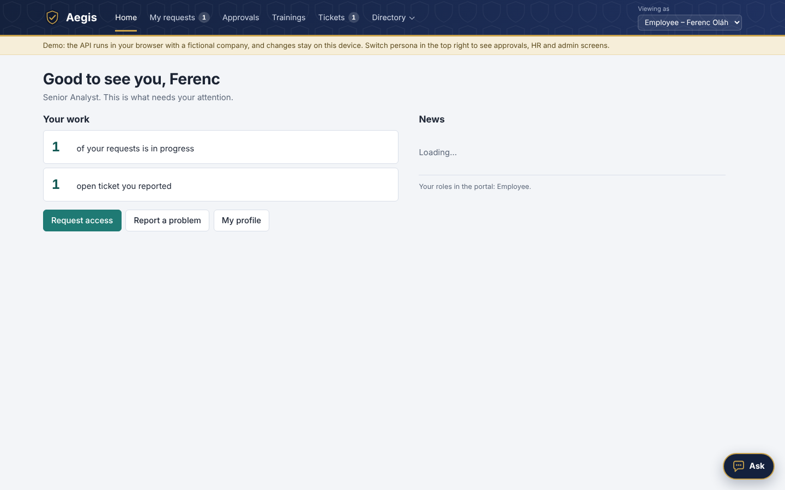 Start page: what needs your attention, and the news | 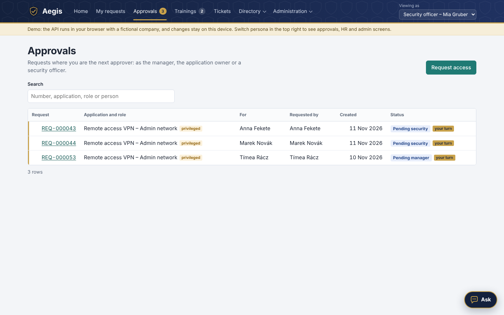 Approvals inbox of a security officer |
| 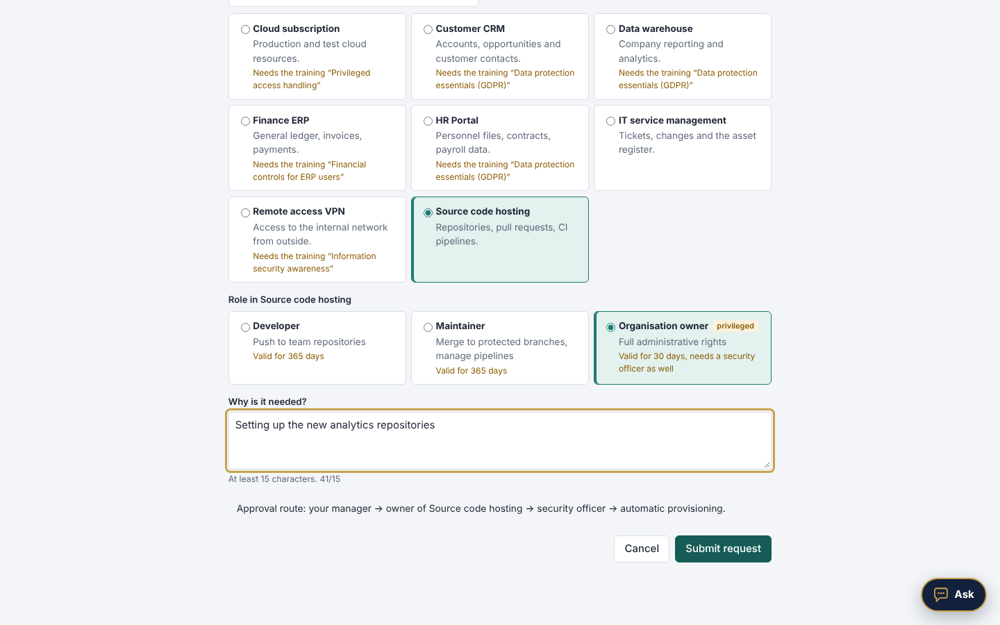 Requesting a privileged role | 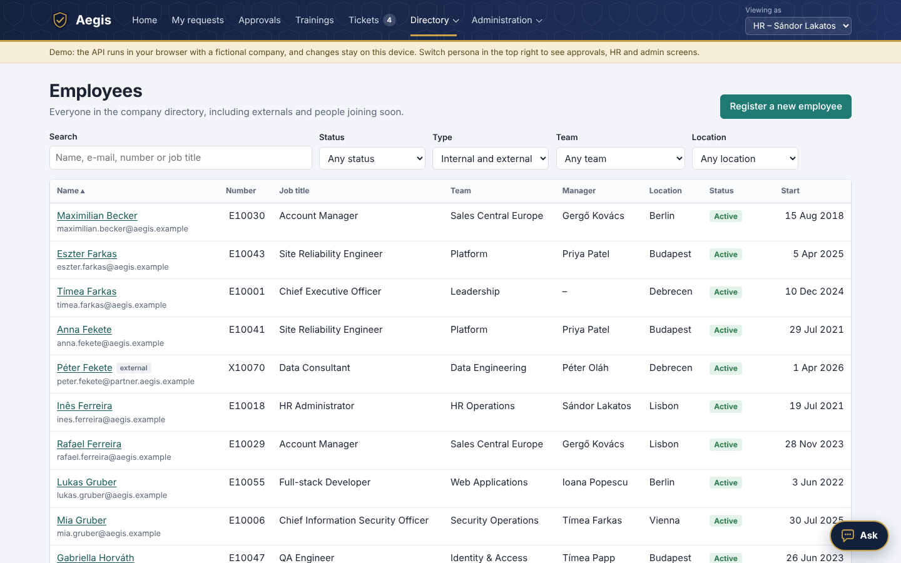 Employee directory (HR) |
| 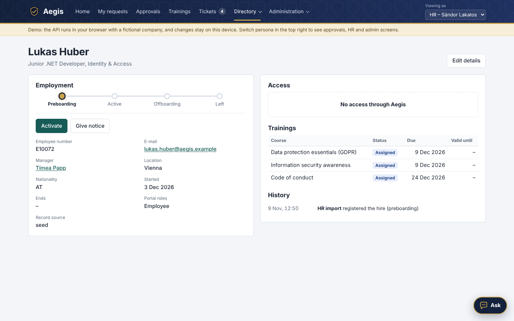 A joiner in preboarding, with HR's lifecycle actions | 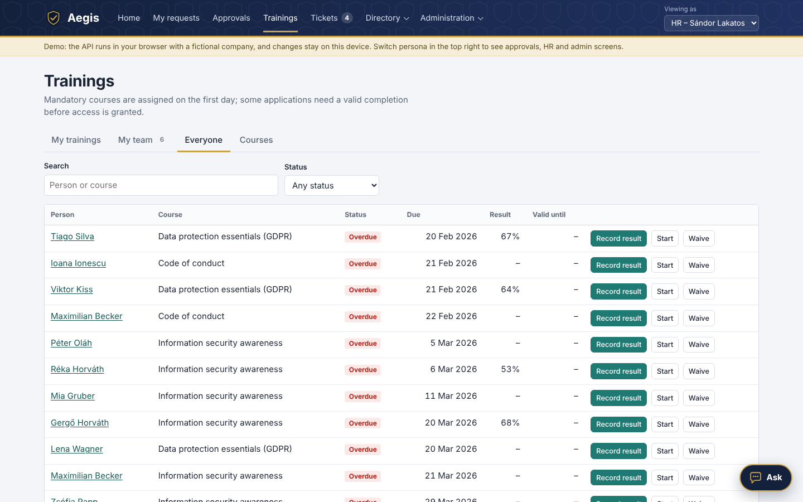 Training compliance across the company |
| 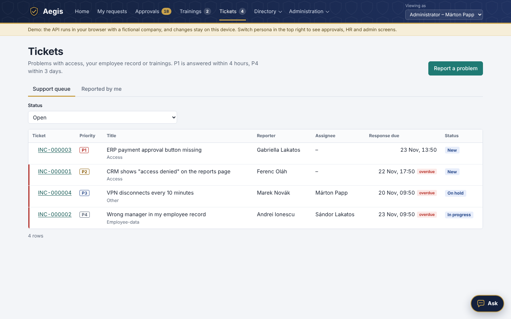 Support queue with response times | 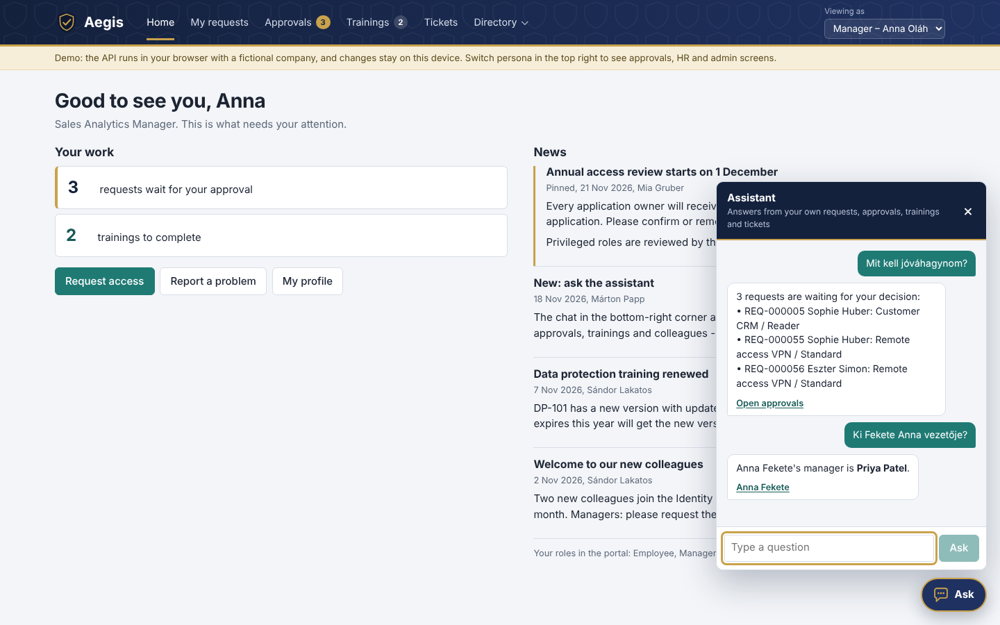 The assistant, asked in Hungarian |
| 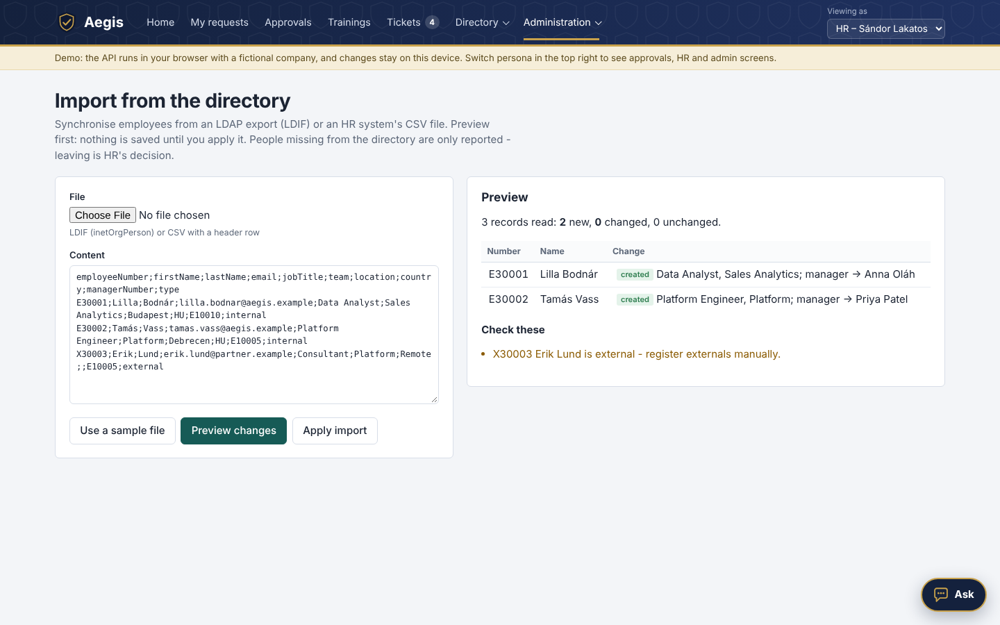 Directory import: preview before saving | 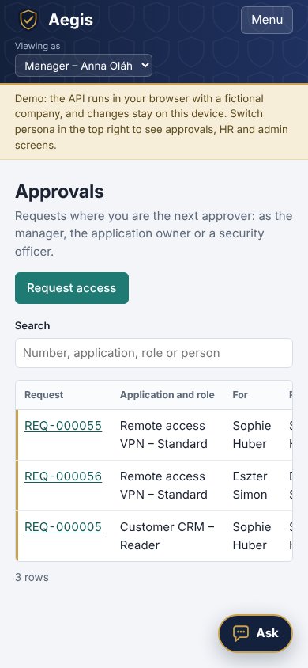 On a phone |

## Background

I worked on an internal identity-and-access portal (employee registration, access ordering, trainings, exports) that started as VB.NET Web Forms and was being moved to ASP.NET Core and a modern front end. Aegis is my from-scratch take on what that system can look like when it is built new: workflows as explicit state machines instead of ever-growing conditionals, one central place for errors, a real test pyramid – including the performance and UI layers that rarely get built. The companion repository **[AccessDesk](https://github.com/tibortoth8807/AccessDesk)** shows the other half of the story: how to migrate such a legacy application step by step (strangler fig, characterization tests).

All people, companies and data are fictional.

## License

[MIT](LICENSE)
